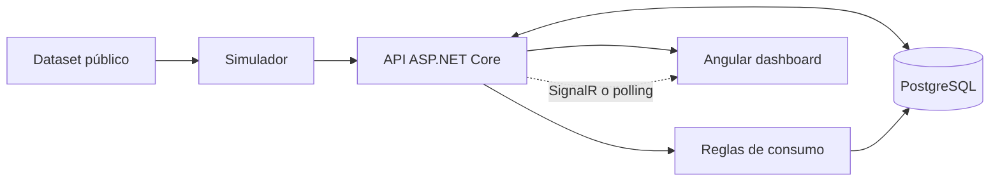

# Water Leak Detection

**Plataforma web de monitoreo de consumo hídrico** — Proyecto personal de Ingeniería de Software y Product Management.

> **Estado:** Discovery y diseño técnico. No existe aún una aplicación implementada ni un despliegue. Proyecto independiente, sin vínculo oficial con Esval y sin acceso a sus medidores o sistemas internos.

## Problema y oportunidad

Una fuga domiciliaria no visible puede provocar consumo continuo o elevado antes de que la persona lo advierta. Una aplicación web podría facilitar la comprensión del consumo y dar señales preventivas; **una anomalía no confirma una fuga**.

## Producto propuesto

Dashboard responsivo para consultar lecturas, consumo diario y mensual, tendencias por período, estado de actualización y alertas explicativas. Se demostrará con **telemetría pública reproducida de forma simulada**, no con datos en tiempo real de Esval.

## MVP

| Incluido | Fuera de alcance inicial |
|---|---|
| Dashboard y gráficos históricos | Integración con medidores de Esval |
| API REST y PostgreSQL | WhatsApp real |
| Ingesta y replay de telemetría | Diagnóstico definitivo de fuga |
| Reglas transparentes de consumo sospechoso | Spark / ML obligatorio |
| Alertas y recomendaciones | Gestión de reclamos / compensaciones |

### Arquitectura candidata (sin implementar)

Stack propuesto: Angular, ASP.NET Core/C#, PostgreSQL; SignalR opcional. Se priorizará un monolito modular, sin microservicios innecesarios.

## Datos

Dataset candidato: [Smart Meter Water Consumption Measurements (Zenodo)](https://zenodo.org/records/7506076), mediciones residenciales de 17 hogares. **No incluye etiquetas verificadas de fugas domésticas.** Antes de usarlo, validar esquema, unidad, intervalos, cobertura, licencia y condiciones de reproducción.

## Hoja de ruta

- [x] Contexto del problema, usuarios y alcance preliminar.
- [x] Documentación inicial de producto y software en Confluence.
- [ ] Exploración reproducible del dataset y contrato de lecturas.
- [ ] Backend, persistencia y endpoints con pruebas.
- [ ] Dashboard conectado a API y consultas históricas.
- [ ] Simulación de telemetría y actualizaciones automáticas.
- [ ] Alertas explicativas, escenarios de prueba y accesibilidad.
- [ ] CI/CD, despliegue de demostración y pruebas con usuarios.

## Documentación

- [Alcance de producto](docs/product-scope.md)
- [Arquitectura de software](docs/architecture.md)
- [Datos y telemetría](docs/data-research.md)
- [Confluence](https://timorah.atlassian.net/wiki/spaces/waterleakd)

## Relación con el curso Big Data

El curso Big Data continuará por separado con **datos de vuelos** y Spark ML. Este repositorio está dedicado exclusivamente al proyecto personal de software hídrico. El uso de ML en este producto sería una mejora futura condicionada a datos y validación.

## Avisos

No publicar datos personales, secretos ni archivos grandes del dataset. No prometer ahorros ni precisión real sin validación; distinguir siempre reproducción simulada, anomalía y fuga confirmada.
