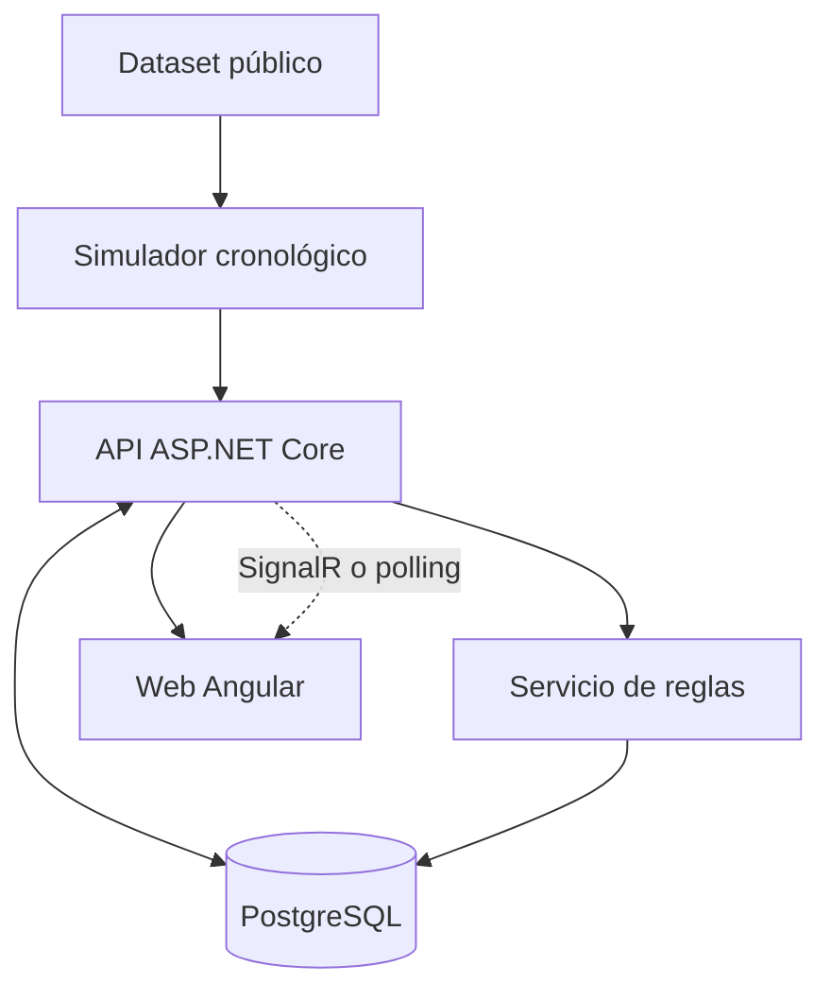

# Architecture — Propuesta, no implementada

## Diagrama lógico

## Decisiones
- Monolito modular para simplificar desarrollo y pruebas.
- API REST, servicios de aplicación y reglas separadas de controladores.
- Validar y almacenar lectura con identidad de medidor, fecha y volumen normalizado.
- Cálculos agregados que distingan falta de cobertura de consumo igual a cero.
- Actualización automática opcional: comenzar con polling; evaluar SignalR posteriormente.
- ML solo si se valida su utilidad; no introducir Spark como requisito artificial.

## Entidades preliminares
- `Household(id, displayName)` — vivienda ficticia o anonimizada.
- `Meter(id, householdId, unit)` — medidor lógico.
- `MeterReading(id, meterId, recordedAtUtc, cumulativeVolumeLiters, source)`.
- `Alert(id, meterId, startUtc, endUtc, reason, status, createdAtUtc)`.

El dataset original debe revisarse antes de decidir tipos, restricciones y semántica de volumen. Evitar duplicados, reinicios de contador y valores imposibles.

## Endpoints candidatos (NO implementados)
| Verbo | Endpoint | Función |
|---|---|---|
| GET | `/api/demo/households` | Hogares de demostración |
| GET | `/api/households/{id}/consumption?from=&to=` | Serie e indicadores |
| GET | `/api/households/{id}/alerts` | Alertas |
| POST | `/api/demo/replay` | Inicio de simulación solo en entorno demo |
| GET | `/health` | Salud de aplicación |

## Requisitos no funcionales
Entrada idempotente, validación robusta, logging sin información sensible, controles de autorización si existen cuentas, pruebas automatizadas y rendimiento adecuado para una demo de un hogar.
